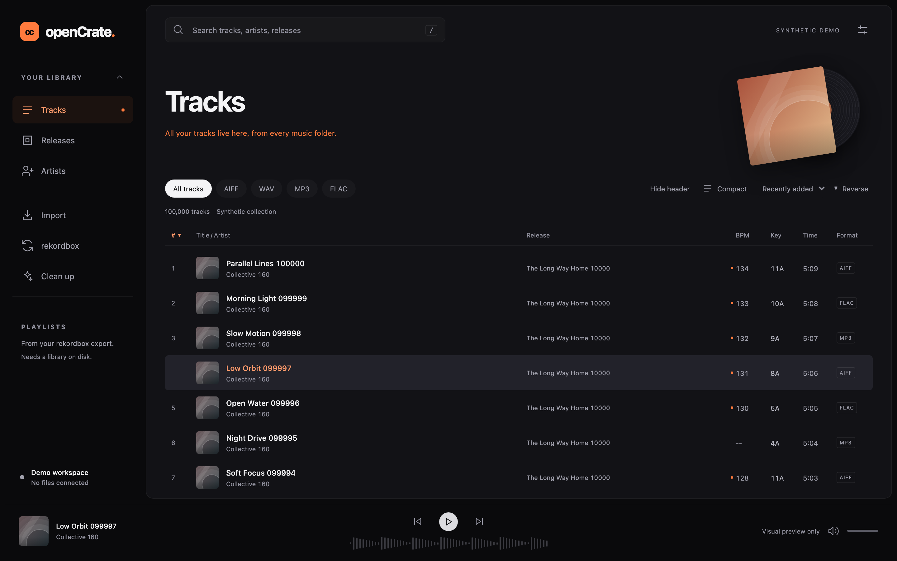

# openCrate

openCrate is a free desktop app for DJs that keeps a music library in order. It brings new downloads into a tidy
`Artist/Release` folder library, shows and plays the whole library with rekordbox's cues on a waveform, fixes tags
and files across it, and works alongside rekordbox, which stays in charge of playlists, cues and beat grids.

It runs on Windows and macOS, is built with Rust, Tauri 2 and React, and is licensed GPL-3.0-or-later.

**Status: early test version (0.1.0).** It works on real music, but only its developer has used it so far, and the
installers are unsigned. Try it on a copy of a small folder before you point it at the library you play from.



Contents: [What it does](#what-it-does) · [What it changes](#what-it-changes-on-your-computer) ·
[Get the app](#get-the-app) · [First start](#first-start) · [A tour](#a-tour) · [How it works](#how-it-works) ·
[Development](#development) · [Contributing](#contributing)

## What it does

- openCrate watches the folders your downloads land in, from any shop or source. Each finished release shows on
  the Import screen as a grid of its tags, with where every file will go. Type over any tag or look the release up
  on MusicBrainz, then import it: the files are copied into your music folder in the layout you chose, converted to
  another format if you ask, and the downloads stay as they were.
- Your library is listed by track, release and artist, with search, filters and the columns you choose. The player
  draws a waveform coloured by sound, with rekordbox's hot cues and memory cues on it.
- The track editor works on one track or many, with cleanup rules, saved recipes and undo. The Clean up screen
  handles genre spellings, messy titles, moved files, missing album art, crates and the folder layout, and its
  experimental Reorganize tool is for a library that grew without a plan.
- Your rekordbox playlists, cues and beat grids come from an XML export, or straight from rekordbox's library if
  you turn that on. New tracks and crates go back through an XML file or, with writing turned on, straight into
  rekordbox's library after a backup.
- Crates are your own track lists, kept in openCrate. Any list can be saved as an M3U8 playlist or a CSV file.

## What it changes on your computer

- Download folders are never changed. Importing copies files, and the originals stay where they are.
- The music you already have is indexed where it is, without moving or renaming it. Files change only when you
  choose: tags you edit or accept, releases you import, and files you tidy, re-file or reorganize from Clean up or
  Settings. A file is never moved over another one. A duplicate you resolve goes to an archive folder next to your
  music folder; it is not deleted.
- rekordbox's library is left alone unless you turn on reading it in Settings, behind a warning. Writing is a
  second, separate switch. openCrate reads and writes only while rekordbox is closed, takes a backup first, and
  never deletes a playlist there. It removes a track entry in one case only: when you resolve a duplicate, the two
  entries for one recording become one, keeping every playlist place, My Tag and cue. Backups are listed in
  Settings and can be restored.
- When writing is on, rekordbox is told where a moved file went. Serato, Traktor, M3U playlists and anything else
  that remembers file paths are not, so their links to moved files break.
- openCrate goes online only for lookups you ask for: MusicBrainz and the Cover Art Archive, which need no
  account, and Discogs if you add your own token.
- openCrate keeps its own data (its database, rekordbox backups and its rekordbox XML file) in the computer's local
  app data folder, never in your music folder:
  - Windows: `%LOCALAPPDATA%\com.opencrate.desktop`
  - macOS: `~/Library/Application Support/com.opencrate.desktop`

  Deleting that folder, with openCrate closed, starts openCrate again from nothing. Your music is not in it, but
  the backups of rekordbox's library are, so keep any you may need.

## Get the app

Test builds are on the [Releases page](https://github.com/Calvin-Zikakis/openCrate/releases): a macOS disk image
for Apple silicon, built on the maintainer's Mac. For Windows, or for the newest code on either platform, build
the installer yourself with one script, which checks for the tools it needs first. The scripts do what the
Installers workflow does on GitHub, which collaborators can also start by hand from the Actions tab.

### Windows

You need a 64-bit (x64) PC with Windows 11. Windows 10 may work but has not been tried.

1. Open PowerShell (Windows key, type PowerShell) and get the code:

   ```
   winget install Git.Git
   git clone https://github.com/Calvin-Zikakis/openCrate.git
   cd openCrate
   ```

   Skip the first line if Git is already installed. After installing it, open a new PowerShell window before you
   clone. Later, run `git pull` in the same folder to get the newest code.

2. Build the installer:

   ```
   powershell -NoProfile -ExecutionPolicy Bypass -File scripts\windows\build.ps1
   ```

   Windows does not run PowerShell scripts by default. `-ExecutionPolicy Bypass` allows this one run and changes
   no setting.

The first run checks for each tool the build needs. For anything missing it says what is wrong and offers to
install it with winget, asking before each one:

- Git.
- Node.js 24, the version in `.nvmrc`.
- Visual Studio 2022 Build Tools with "Desktop development with C++", which includes the Windows SDK. It needs
  several GB of disk and takes a while to install. If Build Tools is already installed without that workload, add
  it in Visual Studio Installer with Modify.
- Strawberry Perl in `C:\Strawberry`. The rekordbox reader compiles OpenSSL, and OpenSSL's build needs Perl
  modules that other Perls on Windows (such as the one that comes with Git) lack.
- Rust, through rustup. The script then installs the exact Rust version in `rust-toolchain.toml`.

Windows asks for administrator permission for most of these. If the script says a tool was installed but it
cannot see it yet, open a new PowerShell window and run the build line again.

Options go at the end of the build line:

- `-Yes` installs missing tools without asking about each one.
- `-Test` runs the Rust tests before building.
- `-TargetDir D:\b` builds in another folder instead of `C:\t`. Keep the path short: OpenSSL's build fails on long
  paths, which is why the default sits at the root of the drive.

The first build compiles everything, including OpenSSL and SQLCipher, and takes a while. Later builds reuse the
build folder and are much quicker. At the end the script prints the installer's path, normally:

```
C:\t\release\bundle\nsis\openCrate_0.1.0_x64-setup.exe
```

If the script stops, its red "Stopped:" line names the step that failed, and the messages above it say why.

### macOS

You need the Xcode Command Line Tools (`xcode-select --install`), Node.js (any recent version, from nodejs.org or
Homebrew) and Rust (from [rustup.rs](https://rustup.rs)). Then:

```sh
git clone https://github.com/Calvin-Zikakis/openCrate.git
cd openCrate
scripts/mac/build.sh
```

If the installed Node is not version 24, the script fetches Node 24 for this build only. It prints where the disk
image is, normally `target/release/bundle/dmg/openCrate_0.1.0_aarch64.dmg` on an Apple silicon Mac. The app itself
is at `target/release/bundle/macos/openCrate.app`. If `CARGO_TARGET_DIR` is set, both are under that folder
instead of `target`.

### Install it

- On Windows, run the `-setup.exe`. It installs for your user only and needs no administrator rights. It is
  unsigned, so SmartScreen warns when you open it: choose More info, then Run anyway. To remove openCrate, use
  Settings, Apps.
- On macOS, open the `.dmg` and drag openCrate to Applications. A build copied from another Mac is blocked the
  first time because it is unsigned: open it once, then allow it under System Settings, Privacy & Security, Open
  Anyway. To remove it, move it to the Trash.

Removing the app leaves its data folder (see above) in place.

### ffmpeg (optional)

openCrate uses ffmpeg to convert formats when it imports, and to check whether a lossless file was made from an
MP3. Without it, files are imported in their own format and that check does not run. Install it with
`winget install ffmpeg` on Windows or `brew install ffmpeg` on macOS. openCrate looks for it on the `PATH`, and
on macOS in Homebrew's folders too.

## First start

The first time openCrate opens, a welcome panel offers three steps. Each can be done or changed later in Settings.

1. **Music folders.** Pick the folder your library lives in. openCrate reads every file's tags and shows its
   progress. Nothing is moved or renamed.
2. **Watch folders.** Pick the folders your downloads land in. Releases already there count as old; new ones show
   on the Import screen.
3. **rekordbox.** Opens the rekordbox screen, where you can read an XML export (see below).

To try it without any risk to your real library, make a test folder with a copy of a few albums and use it as the
music folder, and a second folder with a few downloads as the watch folder.

## A tour

### Library and player

- Search with the box at the top, or press `/`. It matches titles, artists and releases from the first letters of
  each word.
- The library has three views: Tracks, Releases and Artists. Open a release or an artist to see its tracks. A file
  that cannot be found is marked Missing; one on an unplugged drive is shown as offline instead.
- In the track list you choose which columns show, drag a heading to move its column, drag a column's edge to
  resize it, and click a heading to sort. The reset icon puts the columns back. **Filter** narrows the list by
  genre, a year range and when tracks were added, and the format filter lists every format in your library.
  **Compact** fits more rows.
- Cmd-click (Ctrl-click on Windows) and Shift-click choose several tracks, and Cmd/Ctrl+A chooses all of them.
  Right-click for Play next, Add to queue, Edit details and crates.
- To play a track, double-click it, press Enter or Space, or use the play button that appears on a row under the
  pointer. Space pauses. At the end of a track the next one starts, and tracks that cannot be played are skipped.
- The waveform across the top of the player scrolls past the playhead and is coloured by sound: lows in blue, mids
  in orange, highs in white. The bar under the controls shows the whole track; click or drag it to move. Hot cues
  from rekordbox show in green and memory cues in white. **Cues and grid** lists a track's cues, loops and beat
  grid as rekordbox wrote them.

### Crates and exports

Make a crate with the + beside CRATES in the sidebar, then drag tracks onto its name. Clicking the CRATES heading
shows every crate as cards. Within a crate, drag tracks into your own order, or move one with Alt+Up and Alt+Down.
Rename or delete a crate from its menu; deleting it leaves the tracks in your library.

Any list (all tracks, a crate, a playlist, a release or an artist) has **Export M3U8 playlist...** and
**Export CSV...** under its title. The M3U8 lists each track's file for other players; the CSV has title, artist,
release, BPM, key, length, format and path for a spreadsheet.

### Import

The Import screen lists what is in your watch folders, one row per track, and says whether each release has
finished downloading.

- Every tag is a cell you can type over; Enter moves down a row. The Whole release row fills every file of
  a release at once, and right-clicking a value applies it to the whole release. A mark beside a value says where it
  came from when it is not the file's own tag: `?` the file name, `*` tidied, `•` a lookup, `✎` typed by you. Genre
  and label cells suggest values your library already uses. What you type goes into the imported copy only.
- **Look up** asks MusicBrainz about one release, and **Look up all** asks about every one. What it finds fills the
  cells, marked as a lookup, and can still be typed over. With a Discogs token in Settings, Discogs is asked when
  MusicBrainz has nothing.
- **Import** copies a release into your music folder and reads it into the library; **Import all** does every
  finished release after one confirmation. **Import destination** sets the music folder, and optionally a crate
  and a rekordbox playlist the new tracks go to.
- **Import settings** choose the formats ("Convert lossless files to" and "Convert lossy files to": AIFF, WAV,
  FLAC, MP3, or keep them as they are) and whether names are tidied (stray separators removed, "A;B" made
  "A, B"). A file already in the chosen format is never converted. A lossless file that looks like it was made
  from an MP3 is flagged.
- Files are placed by the folder layout in Settings, Artist / Album / Track by default, for example
  `Studio 001/Between Spaces/01 - Studio 001 - Night Drive.aif`. A remix is filed under the remixer; a VIP stays
  with the original artist. Tags are written as ID3v2.3, which rekordbox reads.
- A file the same size and length as one already in your library is marked as a duplicate. **Remove from the
  list** hides a release you do not want, and the Removed card can put it back. **Recently imported** lists the
  last batch.
- In the import settings you can let releases whose tags need no checking import themselves once they finish
  downloading, optionally with a saved recipe. The rest wait for you. This works while openCrate is open.

### Editing tracks

Choose one or more tracks and press Cmd/Ctrl+I, or right-click and choose **Edit details**. A field every chosen
track shares shows its value; one that differs shows "Several values" and is left alone unless you type in it.
Cleanup buttons (number prefixes, casing, links and junk, separators) list what they would change before you save.
Saving writes the files' tags. **Save as recipe** keeps the typed values and cleanup rules under a name to use
again. **Your fields** are fields of your own, such as an energy or a mood, kept in openCrate rather than in the
files. A track's cover can be chosen, taken from its folder or removed.

### Clean up

The Clean up screen fixes things across the whole library. Nothing changes until you choose it.

- **Recent changes** lists every save with what the files held before; **Undo** puts the newest back.
- **Moved files** finds tracks whose file was moved or renamed outside openCrate and links them again. **Look in a
  folder...** searches a folder you pick for the ones still missing.
- **Genres** groups genres spelled two ways ("Deep House", "deep-house") and suggests the commonest spelling.
- **Titles and artists** lists track numbers in titles, links and promo text, all-capitals names, stray separators,
  and "Artist - Title" titles on tracks with no artist. Tick the fixes to write.
- **Crates** sorts a crate for good, merges one crate into another, or compares two.
- **Folder layout** re-files music already in your folder to match the layout, only the files you tick.
- **Album art** lists releases with no picture. A cover can come from an image beside the files, from the Cover
  Art Archive, or from an image you choose, and goes into every file of the release.
- **Reorganize library (experimental, use at your own risk)** is for a library that grew without a plan. It fills in
  thin tags with MusicBrainz lookups, then moves files into the folder layout in sittings, 50 files at a time, and
  tells rekordbox where they went. It needs rekordbox closed and reading and writing turned on. Any of the last 20
  sittings can be put back, in any order. Read its warnings before you start.

### rekordbox

openCrate can learn about your rekordbox library in two ways.

- From an XML export. In rekordbox choose File, Export Collection in xml format, then pick the file on openCrate's
  rekordbox screen with **Choose export...**. openCrate reads tempo, key, cues, beat grids and your playlists, which
  appear in the sidebar. **Read again** picks up a newer export. If the export points at your music under another
  drive or folder, openCrate suggests the folder it belongs to; **Use this** accepts it.
- Directly, once "Let openCrate read rekordbox's library directly" is on in Settings. **Read from rekordbox**
  backs up rekordbox's library and reads the copy. rekordbox must be closed, including its background agent. This
  also brings in My Tags. If rekordbox changes version, openCrate asks again before reading.

Sending tracks to rekordbox without writing to its library:

- **New in your library** lists tracks openCrate filed that rekordbox does not have yet. Tick them and press
  **Send to rekordbox**. They go into openCrate's own XML file, in a playlist named "openCrate new tracks".
- In **Crates for rekordbox**, a crate you switch on goes into the same file as a playlist, in a folder named
  "openCrate crates". After changing a crate, press **Update file**.
- In rekordbox, the first time only: Preferences, Advanced, rekordbox xml, and choose openCrate's file (its path is
  shown) as the Imported Library. Then open rekordbox xml in rekordbox's tree and drag the tracks or playlists
  into your own.

With "Let openCrate write to rekordbox's library" also on, and rekordbox closed:

- New imports go straight into rekordbox, into a playlist named "Imported" at the top of its tree. If rekordbox is
  open at the time, they wait on the rekordbox screen until you press **Add to rekordbox**.
- Drop tracks on a rekordbox playlist in the sidebar to add them to it, or a crate on a rekordbox folder to make it
  a playlist there; openCrate asks first. Tracks rekordbox does not have yet are added to its collection. The
  playlist browser can make new playlists and folders.
- **Sync with rekordbox** compares each track's title, artist, album, year and label with rekordbox's. A change on
  one side goes to the other; where both changed, you pick. Nothing happens until you tick it and press Sync.
- Files openCrate tidies, re-files or reorganizes are updated in rekordbox too, and resolving a duplicate in the
  Library check merges rekordbox's two entries for it into one.

Every read and write starts with a backup of rekordbox's library. Settings lists them (the last 20 are kept, plus
any you pin), and **Restore...** puts one back. Direct reading and writing have been checked with rekordbox 7 on a
test library.

### Settings

Settings opens with Cmd+, on macOS and Ctrl+, on Windows. It has a search box and a jump list for its groups:

- Appearance: theme (match the computer, dark or light), key notation (as rekordbox wrote it, Camelot, Open Key or
  musical), compact rows, reduced motion.
- Music folders and Watch folders: add, read again, switch off or remove. Removing a folder removes it from
  openCrate only; no file is touched.
- Folder layout: how imported music is arranged, Artist / Album / Track by default, or a pattern of your own.
- Library check: folder names made from untidy tags, recordings filed more than once, and files whose tags could
  not be read, with why. **Tidy...** moves a folder's files to the tidy name.
- Lookup keys: a Discogs token, and an AcoustID key saved for fingerprint lookups in a later version. Keys stay on
  this computer and are sent only to the service they belong to.
- rekordbox: the reading and writing switches, and the list of backups.

### Keyboard

| Key | Does |
| --- | --- |
| `/` | Search |
| Up, Down, Home, End | Move through a list |
| Enter or Space | Play the chosen track; Space pauses |
| Cmd/Ctrl+A | Choose every track in the list |
| Cmd/Ctrl+I | Edit the chosen tracks |
| Alt+Up, Alt+Down | Move a track within a crate or your own order |
| Cmd+, (macOS), Ctrl+, (Windows) | Settings |

## How it works

openCrate is a Tauri 2 app. A Rust process does all the work: reading folders and tags, the database, imports,
playback and rekordbox. The window is a React interface drawn by the system's web view (WebView2 on Windows, WebKit
on macOS). The interface asks the Rust side for a screenful of rows at a time, so a long library scrolls without
being loaded whole.

The library database is SQLite, in the app data folder. It holds metadata only: tags, file identities, crates,
import history, the undo journal and what rekordbox has. The audio stays in your files. Each file is recognised by
the file system's own identity as well as its path, so a file moved or renamed outside openCrate can be found
again. The database is backed up before its layout is upgraded.

```mermaid
flowchart LR
    W[Watch folder] -->|files stop changing| G[Group into releases]
    G --> P[Plan: tags, file names,<br>lookups, what you typed]
    P -->|folder layout| S[Stage a copy]
    S -->|ffmpeg, if a format was chosen| C[Convert]
    C --> T[Write tags and cover]
    T -->|hard link, never over a file| M[Music folder]
    M --> L[(Library database)]
    L -.->|writing on| R[rekordbox]
```



An import goes through these steps: a download folder is watched until its files stop changing; the files are
grouped into releases; a plan is made from the tags, the file names, lookups and what you typed, with the folder
layout giving each file's place; a copy is staged, converted with ffmpeg if you chose a format, and tagged; then it
is moved into the music folder, never over an existing file, and read into the library. If openCrate stops in the
middle, the next start finishes or sets aside the unfinished import.

rekordbox stays the owner of analysis: BPM, key, beat grids and cues come from rekordbox, and openCrate shows
them. The XML export is read directly. rekordbox's own library (`master.db`) is an encrypted SQLite database; it
is read and written through the rekordbox crates vendored from rbxport (`vendor/rbxport`), always after a backup and
only while rekordbox is closed.

The player decodes with symphonia and plays through cpal. openCrate computes the coloured waveforms from the
audio itself; the whole-track overview is kept in the database.

| Part | Job |
| --- | --- |
| [`src/`](src) | The React interface |
| [`src-tauri/`](src-tauri/README.md) | The desktop app: window, commands, background work |
| [`crates/oc-core-db`](crates/oc-core-db/README.md) | The library database: schema, queries, snapshots and recovery |
| [`crates/oc-ingest`](crates/oc-ingest/README.md) | Download folders: partial files, waiting for a download to finish, grouping releases |
| [`crates/oc-organize`](crates/oc-organize/README.md) | Naming rules: folder layouts, safe file names, path limits, title parsing |
| [`crates/oc-paths`](crates/oc-paths/README.md) | File identity, and mapping paths to rekordbox's form |
| [`crates/oc-tag`](crates/oc-tag/README.md) | Reading and writing tags and album art |
| [`crates/oc-lookup`](crates/oc-lookup/README.md) | MusicBrainz and Discogs queries, and matching answers to files |
| [`crates/oc-convert`](crates/oc-convert/README.md) | Format conversion and the fake-lossless check, through ffmpeg |
| [`crates/oc-publish`](crates/oc-publish/README.md) | Moving a staged file into the library safely, with crash recovery |
| [`crates/oc-player`](crates/oc-player/README.md) | Decoding and playing a track, and the waveforms |
| [`crates/oc-rekordbox`](crates/oc-rekordbox/README.md) | rekordbox XML, and its `master.db` |
| [`vendor/rbxport`](vendor/rbxport/VENDORED.md) | The rekordbox database crates, vendored from rbxport |

## Development

You need Node.js 24 with npm, and Rust 1.99.0 (rustup installs it from `rust-toolchain.toml`). On macOS you also
need the Xcode Command Line Tools. On Windows you need the Visual Studio Build Tools with C++ and Strawberry Perl,
and you should set two variables, because SQLCipher's OpenSSL is compiled from source:

```powershell
$env:OPENSSL_SRC_PERL = 'C:\Strawberry\perl\bin\perl.exe'
$env:CARGO_TARGET_DIR = 'C:\t'
```

The commands below use `npx -y -p node@24 -p npm@11 npm`, which runs npm on Node 24 even when another version is
installed. With Node 24 installed, plain `npm` does the same.

### Run it

```sh
npx -y -p node@24 -p npm@11 npm ci
npx -y -p node@24 -p npm@11 npm run dev            # in a browser, with a synthetic demo library in memory
npx -y -p node@24 -p npm@11 npm run tauri -- dev   # the desktop app
```

Started with no setting, the desktop app opens the same library as an installed openCrate, in the app data folder.
For development, give it a library of its own:

- `OPENCRATE_DATA=/an/absolute/empty/folder` keeps a library in that folder.
- `OPENCRATE_DEMO=5000` opens a throwaway synthetic library of that many tracks (1 to 100,000), removed when the
  app quits.

```sh
OPENCRATE_DATA=$HOME/opencrate-dev npx -y -p node@24 -p npm@11 npm run tauri -- dev
```

On Windows: `$env:OPENCRATE_DATA = 'C:\opencrate-dev'; npm.cmd run tauri -- dev`.

### Checks

Build the frontend before the Cargo checks, because the app embeds `dist/`:

```sh
npx -y -p node@24 -p npm@11 npm run build            # type check and build
npx -y -p node@24 -p npm@11 npm test                 # unit tests (Vitest)
npx -y -p node@24 -p npm@11 npm run test:browser     # browser tests (Playwright)
cargo fmt --all --check
cargo clippy --workspace --all-targets --locked -- -D warnings
cargo test --workspace --locked
```

The browser tests need Playwright's browsers once:
`npx -y -p node@24 -p npm@11 npm exec -- playwright install chromium webkit`. Without ffmpeg installed, the tests
that need it pass without checking anything. The screenshot above comes from `scripts/screenshots/take.mjs`, run
against `npm run preview`.

On GitHub, the Rust checks (macOS) and the frontend checks (Linux) run for a pull request into `main`. The Rust
checks also run on Windows when a release is published or when started by hand. Pushes start nothing, and the
Installers workflow runs only by hand. Run the checks locally before you push.

### Rules for changes

- Tests use synthetic music and temporary folders only. Never commit audio, a real library database, track names
  from a real library, tokens or API keys.
- Clippy runs with warnings as errors; keep it clean.
- No emojis in documentation.
- The maintainer's planning notes and work log live in `docs/`, which git ignores. The tracked documentation is
  this README, the crate READMEs, and the instructions for coding agents (`AGENTS.md`, `CLAUDE.md`).

## Contributing

Bug reports from your own library are the most useful thing right now; [CONTRIBUTING.md](CONTRIBUTING.md) says
what to include and how a change should look. [SECURITY.md](SECURITY.md) covers what the app touches and how to
report something privately.

## License

GPL-3.0-or-later. See [LICENSE](LICENSE).
