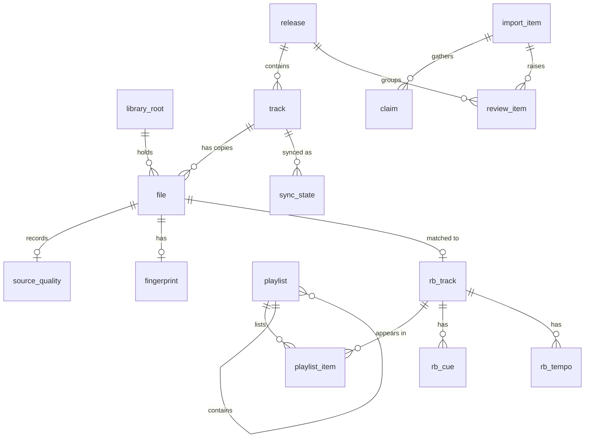

# Data model

The app database (SQLite, local) is the source of truth for files, tags and sync state ([decision 0001](../decisions/0001-sqlite-local-database.md)). rekordbox stays the source of truth for playlists, cues and grids, which the database mirrors read-only. This is the schema planned for version 1, in the order the milestones need it. Names are final enough to review; column details can still move before the first migration.

## Conventions

- Primary keys are `INTEGER`. Times are UTC Unix milliseconds in `INTEGER` columns named `*_ms`.
- Display values are stored as the source gave them. Columns ending in `_key` hold a normalized form (NFC, case-folded, punctuation and diacritics removed) used for matching and search.
- `file.rel_path` is the path relative to its library root, with forward slashes on every OS, written exactly as the name is on disk. If a name is not valid UTF-8, the raw bytes go in `rel_path_raw` and the row is flagged.
- A library root stores its path as the owner typed it (for example a drive-letter path). Remapping a root is one update.
- No audio, waveform peaks or thumbnails are stored in the database. They are cache files.
- The `audit_log` is append-only.

## Tables

### Library

| Table | Columns | Notes |
| --- | --- | --- |
| `library_root` | `id`, `path`, `label`, `kind` (local, removable, network, staging), `online`, `last_seen_ms` | A root that is not reachable is `online = 0`, never deleted. Staging folders are roots too, so a file can be recorded before it is filed |
| `release` | `id`, `artist`, `artist_key`, `title`, `title_key`, `year`, `label`, `catalog_no`, `mbid`, `discogs_id`, `bandcamp_url`, `source` | A release is matched as a unit |
| `track` | `id`, `release_id`, `disc_no`, `track_no`, `title`, `title_key`, `version`, `artist`, `artist_key`, `remixer`, `folder_artist`, `duration_ms`, `bpm`, `musical_key`, `genre`, `mbid_recording`, `created_ms`, `updated_ms` | Version is part of identity. `bpm` and `musical_key` stay empty until the rekordbox read-back fills them |
| `file` | `id`, `track_id`, `root_id`, `rel_path`, `rel_path_raw`, `size`, `mtime_ms`, `container`, `codec`, `bitrate_kbps`, `sample_rate`, `bit_depth`, `channels`, `duration_ms`, `state` (staged, active, archived, missing, offline), `created_ms` | Unique on `(root_id, rel_path)`. `track_id` is empty until the file is identified. A staged file lives under a staging root. Filing updates `root_id` and `rel_path` in place, so `source_quality`, `fingerprint` and every reference stay valid. A track can have several files over time (the active one, archived ones) |
| `source_quality` | `file_id`, `origin`, `container`, `codec`, `bitrate_kbps`, `sample_rate`, `bit_depth`, `claimed_lossless`, `fake_lossless_verdict`, `cutoff_hz`, `checked_ms` | Recorded before any conversion |
| `fingerprint` | `file_id`, `algorithm`, `duration_s`, `data` | Its own table so track rows stay small |

### Import and review

| Table | Columns | Notes |
| --- | --- | --- |
| `import_item` | `id`, `release_key`, `staging_path`, `state`, `release_id`, `plan_json`, `error`, `created_ms`, `updated_ms` | State machine in [import-pipeline](import-pipeline.md) |
| `claim` | `id`, `import_item_id`, `file_id`, `source`, `artist`, `title`, `version`, `release`, `track_no`, `raw_json`, `confidence` | One row per signal per file. The scorer reads these |
| `review_item` | `id`, `import_item_id`, `release_id`, `field`, `current_value`, `proposed_value`, `source`, `confidence`, `status`, `resolved_value`, `created_ms`, `resolved_ms` | Grouped by release in the UI |
| `alias` | `id`, `kind`, `from_value`, `to_value`, `created_ms` | "Always apply this mapping", for example an artist alias |
| `provider_cache` | `provider`, `key`, `response`, `status`, `fetched_ms`, `expires_ms` | Positive and negative answers. Nothing is asked twice |

### rekordbox mirror and sync

rekordbox owns playlists, cues and grids ([decision 0008](../decisions/0008-rekordbox-readback-xml-first.md)). These tables are a read-only mirror, replaced on each read-back.

| Table | Columns | Notes |
| --- | --- | --- |
| `rb_source` | `id`, `kind` (xml, master_db), `path`, `file_mtime_ms`, `last_read_ms`, `entries` | The export file or database copy last read. Used to notice that the file changed |
| `rb_track` | `id`, `rb_source_id`, `rb_key`, `location`, `location_key`, `file_id`, `bpm`, `musical_key`, `rating`, `file_missing` | One row per rekordbox collection entry. `file_id` is set when the decoded location matches an indexed file |
| `rb_cue` | `rb_track_id`, `kind` (cue, loop, memory, fade), `number`, `start_ms`, `end_ms`, `name`, `colour` | The cue markers shown by the player |
| `rb_tempo` | `rb_track_id`, `start_ms`, `bpm`, `meter`, `beat` | The beat grid |
| `playlist` | `id`, `parent_id`, `kind` (folder, playlist), `name`, `position` | rekordbox's folders and playlists |
| `playlist_item` | `playlist_id`, `position`, `rb_track_id` | Points at the rekordbox entry, which points at the indexed file when it matches |
| `sync_state` | `track_id`, `target`, `external_key`, `location_at_sync`, `content_hash`, `synced_ms` | For rekordbox, `external_key` is its TrackID |

`track.bpm` and `track.musical_key` are filled from `rb_track` through the file match.

### Audit

| Table | Columns |
| --- | --- |
| `audit_log` | `id`, `at_ms`, `actor` (user, pipeline, sync), `action`, `subject_type`, `subject_id`, `old_value`, `new_value`, `detail_json` |

## Search and sort

- `search_fts` is an FTS5 table over artist, title, release, label and version, kept up to date by the same code that writes tracks and releases.
- One index per library sort order: artist then release then track number, title, date added, BPM. Each is built for windowed reads (`start`, `count`) with a known total.
- Other indexes: `track(release_id, disc_no, track_no)`, `file(track_id)`, `file(state)`, `review_item(status, release_id)`, `playlist_item(rb_track_id)`.

## Relationships

## Invariants

1. A file's `state` is never set to `missing` while its root is offline.
2. Library views and exports read only files whose `state` is `active`. Staged files never appear in them.
3. `(root_id, rel_path)` is unique, and `rel_path` never starts with a slash or contains `..`.
4. No row is deleted by the import pipeline. A replaced file becomes `archived`.
5. The rekordbox mirror tables (`rb_*`, `playlist`, `playlist_item`) are replaced wholesale on each read-back and never edited by the user. A failed read leaves the previous mirror in place.
6. Every state change in `import_item` and every move or tag write has an `audit_log` row.
7. Migrations are versioned in `PRAGMA user_version` and a snapshot is taken before each one.
