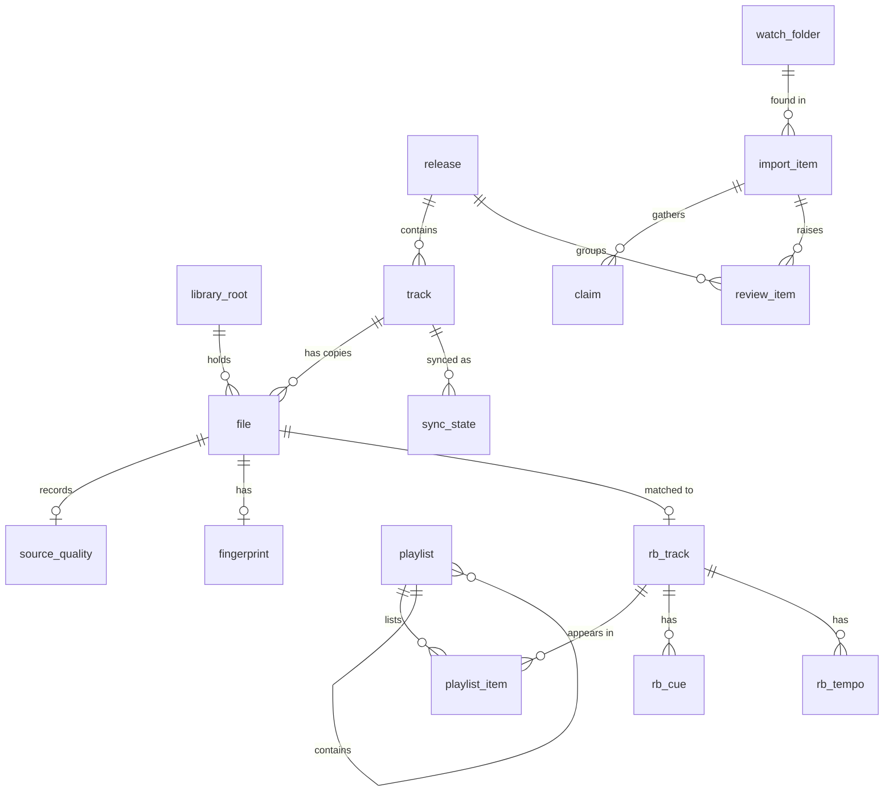

# Data model

The app database is planned to hold files, tags and sync state. rekordbox remains
the source of truth for playlists, cues and grids, mirrored read-only later.
[Decision 0009](../decisions/0009-reduced-foundation-and-recovery.md) limits the
implemented schema v1 to lifecycle state. All library, import, mirror, audit and
search designs below are future and unimplemented, not a version-1 contract.
They need reviewed contracts and later migrations as each feature lands.

## Implemented: lifecycle schema v1

The only table in [001_lifecycle.sql](../../crates/oc-core-db/src/schema/001_lifecycle.sql)
is the STRICT table `app_state`:

| Column | Constraint |
| --- | --- |
| `id` | Integer primary key, constrained to `1` |
| `clean_shutdown` | Non-null integer, constrained to `0` or `1` |

The migration inserts one clean row. The owner marks it dirty on open and clean
on explicit close. A dirty reopen checks database and foreign-key integrity.
Application identity and version are in `PRAGMA application_id` and
`PRAGMA user_version`, not additional tables.

Migrations and version changes commit together. Online backup snapshots precede
upgrades of existing schemas, not initial version-0 creation. Restore writes a
new database without replacing existing recovery material; creation/restore
refuse orphan journals. See [oc-core-db](../../crates/oc-core-db/README.md) for
the caller's local-directory contract and recovery limits.

## Future conventions and unresolved identity

- Primary keys are `INTEGER`. Times are UTC Unix milliseconds in `INTEGER` columns named `*_ms`.
- Display values are stored as the source gave them. Fuzzy metadata search keys
  such as `artist_key` and `title_key` may use NFC, case folding and removal of
  punctuation/diacritics. This is a metadata proposal, not a rule for every
  `_key` column, and never a filesystem identity rule.
- `file.rel_path` and `rel_path_raw` below are a storage sketch. Lossless path
  representation, raw non-text names and uniqueness semantics still need a
  contract. Do not infer identity from fuzzy text or a forward-slash string.
- A root's display path is not enough to define remapping. Volume semantics,
  aliases, XML-prefix mapping and containment through symlinks/junctions remain
  unresolved.
- No audio, waveform peaks or thumbnails are stored in the database. They are cache files.
- The `audit_log` is append-only.

The implemented Location decoder preserves bytes; it does not resolve a file,
fold case or normalize Unicode. R3 in the [plan review](../../plan_review_gpt6.md)
remains open. The proposed `(root_id, rel_path)` uniqueness and `location_key`
must not become migration constraints until filesystem identity is defined and
tested. Existing names must remain distinct from newly sanitized destinations.

## Future tables (unimplemented)

### Library

| Table | Columns | Notes |
| --- | --- | --- |
| `library_root` | `id`, `path`, `label`, `kind` (local, removable, network, staging), `online`, `last_seen_ms` | A root that is not reachable is `online = 0`, never deleted. Staging folders are roots too, so a file can be recorded before it is filed |
| `release` | `id`, `artist`, `artist_key`, `title`, `title_key`, `year`, `label`, `catalog_no`, `mbid`, `discogs_id`, `bandcamp_url`, `source` | A release is matched as a unit |
| `track` | `id`, `release_id`, `disc_no`, `track_no`, `title`, `title_key`, `version`, `artist`, `artist_key`, `remixer`, `folder_artist`, `duration_ms`, `bpm`, `musical_key`, `genre`, `mbid_recording`, `created_ms`, `updated_ms` | Version is part of identity. `bpm` and `musical_key` stay empty until the rekordbox read-back fills them |
| `file` | `id`, `track_id`, `root_id`, `rel_path`, `rel_path_raw`, `size`, `mtime_ms`, `container`, `codec`, `bitrate_kbps`, `sample_rate`, `bit_depth`, `channels`, `duration_ms`, `state` (staged, active, archived, missing, offline), `created_ms` | Proposed uniqueness on `(root_id, rel_path)` is unresolved under R3. Lifecycle/availability states also need R7 review. `track_id` is empty until identified. A staged file would live under a staging root; filing would retain its ID and references. A track may have active and archived files |
| `source_quality` | `file_id`, `origin`, `container`, `codec`, `bitrate_kbps`, `sample_rate`, `bit_depth`, `claimed_lossless`, `fake_lossless_verdict`, `cutoff_hz`, `checked_ms` | Recorded before any conversion |
| `fingerprint` | `file_id`, `algorithm`, `duration_s`, `data` | Its own table so track rows stay small |

### Import and review

| Table | Columns | Notes |
| --- | --- | --- |
| `watch_folder` | `id`, `path`, `label`, `kind` (local, removable, network), `enabled`, `online`, `last_seen_ms`, `added_ms` | The download folders from Settings. Not a `library_root`: openCrate only reads them, and no `file` row ever points into one. An unreachable folder is `online = 0`, never deleted |
| `import_item` | `id`, `watch_folder_id`, `source_rel_path`, `release_key`, `staging_path`, `state`, `release_id`, `plan_json`, `error`, `created_ms`, `updated_ms` | State machine in [import-pipeline](import-pipeline.md). `source_rel_path` is where the release was found, relative to its download folder |
| `claim` | `id`, `import_item_id`, `file_id`, `source`, `artist`, `title`, `version`, `release`, `track_no`, `raw_json`, `confidence` | One row per signal per file. The scorer reads these |
| `review_item` | `id`, `import_item_id`, `release_id`, `field`, `current_value`, `proposed_value`, `source`, `confidence`, `status`, `resolved_value`, `created_ms`, `resolved_ms` | Grouped by release in the UI |
| `alias` | `id`, `kind`, `from_value`, `to_value`, `created_ms` | "Always apply this mapping", for example an artist alias |
| `provider_cache` | `provider`, `key`, `response`, `status`, `fetched_ms`, `expires_ms` | Positive and negative answers. Nothing is asked twice |

### rekordbox mirror and sync

rekordbox owns playlists, cues and grids ([decision 0008](../decisions/0008-rekordbox-readback-xml-first.md)). These tables are a read-only mirror, replaced on each read-back.

| Table | Columns | Notes |
| --- | --- | --- |
| `rb_source` | `id`, `kind` (xml, master_db), `path`, `file_mtime_ms`, `last_read_ms`, `entries` | The export file or database copy last read. Used to notice that the file changed |
| `rb_track` | `id`, `rb_source_id`, `rb_key`, `location`, `location_key`, `file_id`, `bpm`, `musical_key`, `rating`, `file_missing` | One row per collection entry. `location_key` is an unresolved identity placeholder, never a fuzzy metadata key. Setting `file_id` needs a validated filesystem match, not just decoded bytes; `file_missing` needs R7 state review |
| `rb_cue` | `rb_track_id`, `kind` (cue, loop, memory, fade), `number`, `start_ms`, `end_ms`, `name`, `colour` | The cue markers shown by the player |
| `rb_tempo` | `rb_track_id`, `start_ms`, `bpm`, `meter`, `beat` | The beat grid |
| `playlist` | `id`, `parent_id`, `kind` (folder, playlist), `name`, `position` | rekordbox's folders and playlists |
| `playlist_item` | `playlist_id`, `position`, `rb_track_id` | Points at the rekordbox entry, which points at the indexed file when it matches |
| `sync_state` | `track_id`, `target`, `external_key`, `location_at_sync`, `content_hash`, `synced_ms` | For rekordbox, `external_key` is its TrackID |

`track.bpm` and `track.musical_key` are filled from `rb_track` through the file match.

### Audit

| Table | Columns |
| --- | --- |
| `audit_log` | `id`, `at_ms`, `actor` (user, pipeline, sync), `action`, `subject_type`, `subject_id`, `old_value`, `new_value`, `detail_json` |

## Future search and sort

- `search_fts` is an FTS5 table over artist, title, release, label and version, kept up to date by the same code that writes tracks and releases.
- One index per library sort order: artist then release then track number, title, date added, BPM. Each is built for windowed reads (`start`, `count`) with a known total.
- Other indexes: `track(release_id, disc_no, track_no)`, `file(track_id)`, `file(state)`, `review_item(status, release_id)`, `playlist_item(rb_track_id)`.

## Future relationships

## Proposed future invariants

These are design goals, not implemented constraints. R1, R3, R4 and R7 still
gate publication, path uniqueness, sync state and offline/missing behavior.

1. A file's `state` is never set to `missing` while its root is offline.
2. Library views and exports read only files whose `state` is `active`. Staged files never appear in them.
3. Paths must remain within a configured root. The proposed `(root_id, rel_path)`
   uniqueness is not yet a safe identity contract; raw paths, volume semantics
   and alias/containment checks remain unresolved under R3.
4. No row is deleted by the import pipeline. A replaced file becomes `archived`.
5. The rekordbox mirror tables (`rb_*`, `playlist`, `playlist_item`) are replaced wholesale on each read-back and never edited by the user. A failed read leaves the previous mirror in place.
6. Every state change in `import_item` and every move or tag write has an `audit_log` row.

The implemented migration invariant is separate: `PRAGMA user_version` changes
with each committed migration, and an online snapshot precedes each upgrade of
an existing schema. Initial creation needs no version-0 snapshot.
