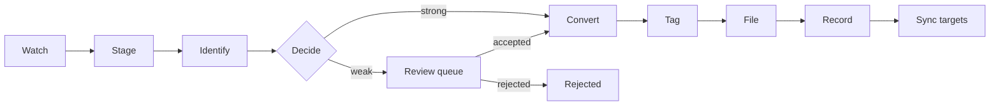
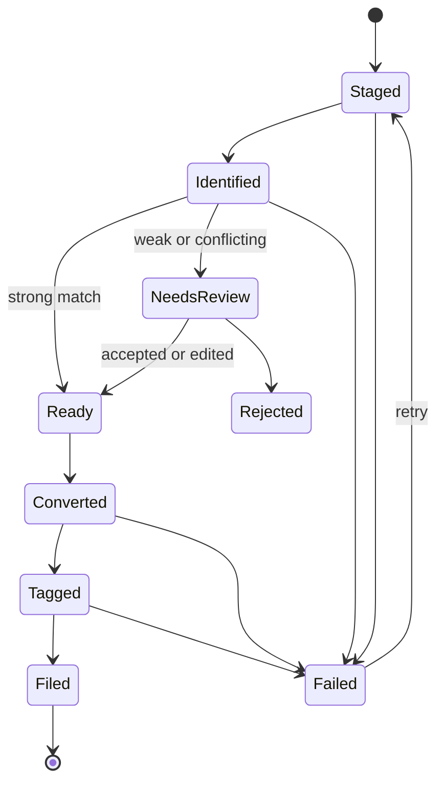

# Import pipeline

How a downloaded release becomes a filed, tagged, converted track in the library. This is the design for milestones 3, 4, 7 and 8 in [BUILD-PLAN](../BUILD-PLAN.md). The rules come from the Game Plan: confident matches file themselves, the rest go to a review queue, and version is part of identity.

## Stages

| Stage | Does | Writes to |
| --- | --- | --- |
| Watch | Sees a new folder or file in a watch folder. Local folders use file-system events; a folder on a network drive is polled | Nothing |
| Stage | Waits until size and modified time stop changing, then copies the release into staging | Staging only |
| Identify | Reads tags, parses folder and file names, reads MusicBrainz IDs already in the tags, and later asks providers. Records the source quality of every file before anything is converted | `import_item`, `file` (state `staged`), `source_quality`, `claim` |
| Decide | Scores the claims. Auto-file needs artist, title and version agreed by at least two different sources with none disagreeing, and the release matched as a unit | `review_item` for anything not strong |
| Convert | Lossless to AIFF (`.aif`), other lossy to MP3. Runs the fake-lossless check first. Original bitrate and format are already recorded | Staging only |
| Tag | Writes the final tags and artwork into the converted file | Staging only |
| File | Computes the destination from the path template, then moves the file into the library root | The library |
| Record | Creates the `track` rows, points each `file` at its library location and marks it `active`, and writes the audit entries and the sync-state rows | The database |

## Where things live

| Place | Location | Why |
| --- | --- | --- |
| Watch folders | Anywhere the owner chooses (the downloads folders) | Where Bandcamp and Soulseek put files |
| Staging | Outside the synced library folder, on the same volume as the library where possible | The sync tool never sees half-written files, and the last step can be an atomic rename |
| Review queue files | A subfolder of staging | Not indexed by anything, not synced |
| Archive | Outside the synced library folder | A replaced file is kept, without Navidrome or the NAS ever seeing the copy |
| Database | The app data directory | See [decision 0003](../decisions/0003-local-library-synced-copy.md) |

## State of an import item

Every transition is written to the database before the next stage starts, so the pipeline can stop at any point and resume. On startup the app compares the staging folders with the `import_item` rows and continues from the recorded state.

## Rules

1. **Dry run first.** Milestone 3 stops after Decide and shows a plan: the proposed destination and tag changes for every file. Nothing is moved into the library until milestone 4.
2. **Never delete the staging copy until the filed copy is verified.** Same volume: an atomic rename. Different volumes: copy to a temporary name beside the destination, compare size and a checksum, rename, then delete the staging copy.
3. **Never overwrite.** If the destination exists, the item stops in review with the reason: same track (a duplicate or an upgrade), or a name clash.
4. **Upgrades.** A better copy replaces the old one and keeps cues, and the old file goes to the archive. A synced track needs database mode (the opt-in path fix) to keep its rekordbox link; otherwise the upgrade waits in review.
5. **Windows paths.** The destination must stay under 260 characters unless long paths are available. When it would not, the file stem is shortened and the change is shown in the plan.
6. **Names.** Forbidden characters are replaced, never deleted. Everything is written as NFC.
7. **The existing library is never touched.** Only new imports run this pipeline.
8. **Everything is audited.** Each move, tag write, conversion and decision adds a row to `audit_log` with the old and new values.

## Failure handling

| Failure | Behavior |
| --- | --- |
| Crash mid-stage | Resume from the recorded state. Partial files carry a `.part` name and are removed on resume |
| Disk full | Stop before the copy: the free space is checked against the size of the release first |
| Destination root offline | The item waits in `Ready`. Nothing is marked missing |
| ffmpeg fails on one file | That file is `Failed` with the error. The rest of the release continues and the release stays out of the library until the owner decides |
| Provider unreachable | Local signals decide. The item may go to review, and the lookup is retried later |
| Tag write fails | The converted file stays in staging. Nothing is filed |

## Fake lossless

Lossless files are checked before conversion for a spectral cutoff that suggests a lossy origin (for example a hard cut near 16 kHz or 19 to 20 kHz). The verdict is stored with the source quality. A suspect file is converted as usual and flagged, and the review queue shows the verdict. The threshold is tuned on known-good and known-bad samples before the check can block anything.
